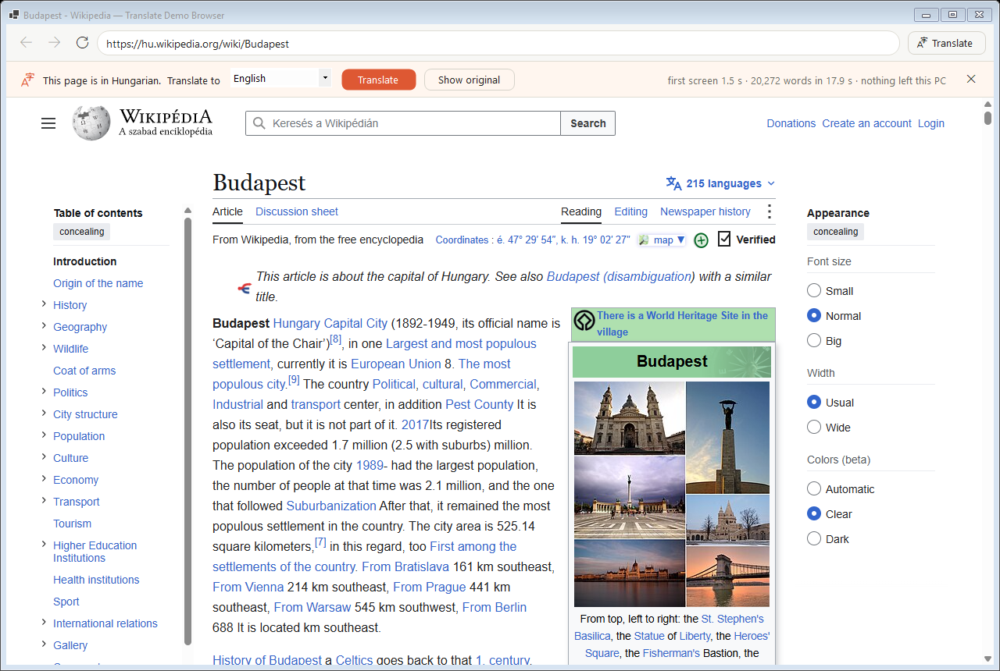

# Translate Demo Browser

A small Windows browser that translates web pages **entirely on your PC**: no page text is sent
anywhere. It is a working end-to-end test of [translate-kit for Windows](https://github.com/sz-kristof/translate-kit/tree/windows-support),
my Windows port of DuckDuckGo's on-device translation library, in a .NET + Chromium (CEF) app.



<sub>Screenshot: the Hungarian Wikipedia article
[Budapest](https://hu.wikipedia.org/wiki/Budapest) (CC BY-SA 4.0), translated to English in the app.</sub>

## What it does

- Detects the page language and offers *"This page is in Hungarian. Translate to English"*.
- Translates on-device with the same models Firefox uses (Bergamot / Marian, int8).
- Keeps the page intact: links, bold text and footnotes survive (block-level HTML translation).
- Visible text first, then the rest of the page. Text the site adds later (pop-ups) is translated
  too: a `MutationObserver` flags changes, so the page is only re-scanned when something changed.
- *Show original* puts the original text back.
- Language pairs without a direct model are pivoted through English (e.g. Hungarian → German).
- Sites get no location, camera, microphone or notification permissions.

## Speed

Pages go to the engine with `tk_translate_batch` on 4 worker threads: everything on screen in one
batch, then the rest in batches of 48 blocks. Ryzen 9 5900X, compared with one call per block on one
thread (`TDB_SINGLE=1 TDB_WORKERS=1`), measured back to back on the live pages:

| page | first screen | whole page |
|---|---|---|
| telex.hu (HU → EN, 2.3k words) | 0.82 s → **0.46 s** | 5.2 s → **2.9 s** |
| index.hu (HU → EN, 5.2k words) | 2.28 s → **0.75 s** | 10.0 s → **5.4 s** |
| hu.wikipedia "Budapest" (HU → EN, 20k words) | 5.21 s → **1.41 s** | 41.2 s → **18.6 s** |
| en.wikipedia "Privacy" (EN → HU, 17k words) | 2.56 s → **0.77 s** | 29.1 s → **11.3 s** |

Each worker holds its own model replica, about 120 MB with these models, so 4 workers use about
0.5 GB per loaded language pair. 8 workers were barely faster for twice the memory
([numbers](https://github.com/sz-kristof/translate-kit/tree/windows-support#throughput-batches-and-workers)).
`TDB_WORKERS` changes it.

Running multi-threaded surfaced a use-after-free in the engine: each worker builds its model replica
on its first batch, and the first one to finish freed the model memory the others were still reading
(5 crashes in 22 runs). Fixed in translate-kit as
[patch 0013](https://github.com/sz-kristof/translate-kit/commit/abcbb5d): 0 crashes in 16 runs.

## Known limitations

- A block is translated as one HTML fragment and written back with `innerHTML`, which keeps links and
  formatting but drops JavaScript event listeners inside that block, so interactive widgets on
  app-like pages can stop working until *Show original*. Firefox avoids this by mapping the translated
  text back onto the existing DOM nodes; that would be the production approach.
- New content is found by polling a `MutationObserver` flag every 1.5 s, not pushed to the host.
- Memory grows by ~120 MB per worker, and models stay loaded until the app closes.

## Build and run

Needs Windows 10/11 x64, the .NET 8 SDK and Visual Studio 2022+ with the C++ workload.

```
git clone -b windows-support https://github.com/sz-kristof/translate-kit translate-kit-windows
git clone https://github.com/sz-kristof/translate-demo-browser TranslateDemoBrowser
```

1. Build `translatekit.dll`: see the [Windows section](https://github.com/sz-kristof/translate-kit/tree/windows-support#building-from-source)
   of translate-kit (`scripts/build-windows.ps1`). The project picks it up from
   `../translate-kit-windows/build/windows/` (override with `-p:TranslateKitDll=<path>`).
2. Download models (English ⇄ Hungarian by default, checksums verified):
   `powershell -ExecutionPolicy Bypass -File fetch-models.ps1`
3. Run: `dotnet run -c Release -- https://hu.wikipedia.org/wiki/Budapest`

Self-test (translates the page, saves `<out>.png` and `<out>.txt` with timings, then exits):

```
TranslateDemoBrowser.exe --autotest https://hu.wikipedia.org/wiki/Budapest C:\temp\budapest
```

## How it works

| file | role |
|---|---|
| `TranslateKit.cs` | P/Invoke bindings to `translatekit.dll`; one engine thread (the C API is single-threaded per context, the engine fans out internally) |
| `page.js` | injected into the page: splits it into translation units, swaps translations in and out |
| `MainForm.cs` | browser UI, detection → translate flow, batching, follow-up translation, self-test |

Known: CefSharp 152 logs a non-fatal `Check failed: observers_.empty()` at exit (even on
`about:blank`); the app still exits cleanly.

## License

MIT for this project's code. translate-kit is Apache-2.0, CefSharp and CEF are BSD-licensed, and the
models are Mozilla's (downloaded by you, not included here).
